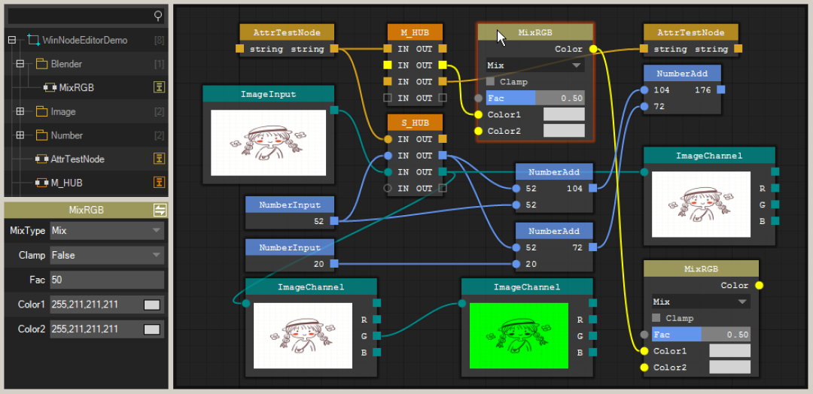
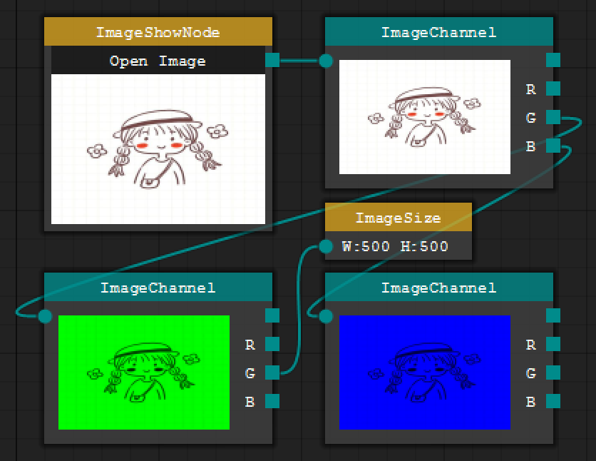

# Node Editor Based on .Net WinForm with Pure GDI+ Support for Draggable Node Drawing

### Project Overview

STNodeEditor is a lightweight and powerful node editor developed based on WindowsForms. It provides a complete set of visual programming frameworks, allowing developers to construct data processing workflows through drag-and-drop connections of nodes. Inspired by professional node editing software such as Blender, GNURadio, and Davinci Resolve, it aims to provide a flexible and scalable node-based programming solution for .NET developers.



Insert image description here.

### Algorithm Principles

#### Core Architecture Design

STNodeEditor adopts a layered architecture design, mainly including the following core components:

1.

1. **STNode (Node Base Class)**: The base class for all custom nodes, providing basic properties of the node (position, size, title, color, etc.) and lifecycle management methods (OnCreate, OnDraw, OnSaveNode, etc.).

1.

2. **STNodeEditor (Node Editor)**: The main control, responsible for managing all nodes, connections, canvas zoom/movement, and event handling.

1.

3. **STNodeOption (Node Option)**: Represents the input/output port of a node, supports single connection (circular) and multiple connection (square) modes, and automatically performs type compatibility checks.

1.

4. **STNodeHub (Node Hub)**: Contains special nodes for splitting and combining lines, supporting dynamic addition/removal of connection points.

1.

5. **STNodePropertyGrid (Attribute Grid)**: Binds to node attributes, supports automatic recognition and display of configurable properties for nodes.

1.

6. **STNodeTreeView (Node Tree View)**: Provides node browsing and drag-and-drop functionality, supports organizing nodes by path.



Insert image description here.

#### Key Algorithm Implementation

##### 1. Connectivity algorithm

-

• **Type Compatibility Check**: Automatically detects whether the data types are compatible when connecting two nodes to prevent mismatched data flow.

-

• **Loop Detection**: Detect the existence of a loop connection through the depth-first search (DFS) algorithm to avoid infinite loops.

-

• **Duplicate Connection Detection**: Check for existing connections with the same source-target to prevent duplicate connections.

-

• **Curve Drawing**: Use Bezier curve algorithm to draw lines, supports curvature adjustment (Curvature attribute).

##### 2. Layout and Rendering Algorithms

-

• **Automatic Layout Computation**: Nodes automatically calculate the best size (AutoSize), dynamically adjusting in size based on the length of the title, number of options, and text width.

-

• **Magnetic Attraction Algorithm**: When moving nodes, automatically adhere to the boundaries or grid lines of other nodes, improving layout accuracy.

-

• **Double Buffering**: Use double buffering technology to reduce flicker and improve rendering performance.

-

• **Regional clipping optimization**: Only redraw the changed regions to improve rendering efficiency.

##### 3. Event Handling Mechanism

-

• **Event Bubbling System**: Mouse events (click, hover, drag) are correctly passed and handled at the node hierarchy level.

-

• **State Management**: Maintain the states of nodes such as selected, active, hovering, etc., and trigger corresponding events.

-

• **Asynchronous operation**: Supports asynchronous loading/saving of canvas to avoid interface blocking.

##### 4. Data Persistence

-

• **Binary Serialization**: Use a custom binary format to save node state, including position, size, connection relationships, attribute values, etc.

-

• **Type-safe Storage**: Providing dedicated serialization/deserialization handlers for each attribute type to ensure data integrity.

-

• **Version Compatibility**: Supports backward compatibility with file formats, allowing new versions to open files saved in older versions.

### Environmental Requirements

#### Development Environment

-

• **Operating System**: Windows 7 and above (recommended Windows 10/11)

-

• .NET Framework: .NET Framework 4.6.1 or higher version

-

• **Development Tools**: Visual Studio 2017 or higher (recommended VS 2019/2022)

#### Running environment

-

• **Client**: Windows operating system

-

• .NET Framework: .NET Framework 4.6.1 runtime

-

• **Hardware Requirements**:

-

• CPU: Intel Core i3 or equivalent processor

-

• Memory: 2GB RAM (recommended 4GB)

-

• Graphics Card: Graphics card supporting DirectX 9 (for hardware-accelerated rendering)

### Installation Steps

Method 1: Compile and Install from Source Code

1.

1. **Clone Project**:

```
git clone https://github.com/DebugST/STNodeEditor.git
cd STNodeEditor
```

1.

2. **Open the solution**:

-

• Open the solution file `WinNodeEditorTest.sln` using Visual Studio

-

• or simply double-click the `WinNodeEditorTest.sln` file

1.

3. **Construction Project**:

-

• Select "Build" → "Rebuild Solution" in Visual Studio.

-

• Ensure the build is successful and there are no errors.

1.

4. **Retrieve the compilation result**:

-

• The compiled program is located in the directory `WinNodeEditorDemo\bin\Debug\`

-

• Main Files: `WinNodeEditorDemo.exe` and `ST.Library.UI.dll`

Method 2: Run the precompiled version directly.

1.

1. **Download the precompiled package**:

-

• Visit the GitHub Releases page to download the latest version.

-

• Or use directly the WinNodeEditorDemo.exe (if it exists) in the root directory of the project.

1.

2. **Run the program**:

-

• Double-click `WinNodeEditorDemo.exe` to start the program.

### Running Steps

#### Starting the program

1.

1. Double-click `WinNodeEditorDemo.exe` to launch the application.

1.

2. After the program starts, it will display the main interface, which includes a node editor, a node tree view, and a property grid.

#### Basic Operations

##### Create Nodes

-

• Find the required node type in the node tree view.

-

• Drag nodes into the editor canvas.

-

• Or add it through code: `stNodeEditor1.Nodes.Add(new MyNode());`

##### Connecting Nodes

-

• Click on the output port of the source node and drag it to the input port of the target node.

-

• The system will automatically check for type compatibility and loop issues.

-

• Supports Ctrl+drag to quickly copy nodes.

##### Edit Nodes

-

• Right-click on the node title to open the context menu

-

• Modify node attributes in the property grid

-

• Use the mouse wheel to zoom the canvas (Ctrl+Wheel)

-

• Drag and move the canvas with middle key.

##### Save and Load

-

• **Save the canvas**: Click the save button on the toolbar or select File > Save to save as a `.stn` file

-

• **Load Canvas**: Click the Open button in the toolbar or select File -> Open to load the previously saved `.stn` file.

#### Advanced Features

##### Custom Node Development

1.

1. Create a class that inherits from `STNode`.

1.

2. Add input/output options in the `OnCreate()` method

1.

3. Rewrite the `OnDrawBody()` method to customize node appearance

1.

4. Rewrite the `OnSaveNode()` and `OnLoadNode()` methods to implement data persistence.

1.

5. Use the `STNodePropertyAttribute` to mark properties so they display in the property grid

##### Node Attributes Configuration

-

• Use the `[STNodePropertyAttribute]` attribute to mark attributes that need to be displayed in the property grid within a node class.

-

• Supports basic types (int, float, double, bool, string, enum) and their arrays.

-

• Customizable attribute descriptors (STNodePropertyDescriptor) support complex types.

### Notes

#### Use Instructions

-

• **Node naming convention**: Node titles should be concise and clear, avoiding the use of special characters.

-

• **Type Matching**: Ensure compatibility of data types when connecting nodes, otherwise the connection will be rejected.

-

• **Loop Avoidance**: Avoid creating node connections that could lead to an infinite loop.

-

• **Performance Optimization**: When there are a large number of nodes, it is recommended to turn off the grid display (ShowGrid = false) to improve performance.

-

• **Memory Management**: Timely release nodes that are no longer in use to prevent memory leaks.

#### Development Notes

-

• **Constructor Requirements**: Custom nodes must provide an empty parameter constructor, otherwise they cannot be created through reflection.

-

• **Thread Safety**: All UI operations must be executed in the main thread, using `Invoke()` or `BeginInvoke()` to handle cross-thread calls.

-

• **Resource Release**: Rewrite the `Dispose()` method to release GDI+ resources (such as Image, Pen, Brush, etc.)

-

• **Exception Handling**: Add appropriate exception handling in `OnSaveNode()` and `OnLoadNode()`, to avoid data corruption.

#### Common Problems and Solutions

##### Connection Failure

-

• Check if the data types are compatible

-

• Check if the same connection already exists.

-

• Check if a loop is formed

-

• View status bar prompt information

##### Rendering Exceptions

-

• Confirm the correctness of .NET Framework version

-

• Try disabling hardware acceleration: `this.SetStyle(ControlStyles.OptimizedDoubleBuffer, false);`

-

• Check if there are any exceptions in the custom drawing code.

##### Performance Issues

-

• Reduce the number of nodes or simplify the appearance of nodes

-

• Close unnecessary visual effects (grid, borders, magnet effect)

-

• Use CanvasScale to control the scaling level.

### Folder Structure Introduction

```
STNodeEditor/
├── .gitignore # Git ignore file configuration
├── LICENSE               # MIT Open Source License
├── README.md  # The original README file for the project
├── README2.md  # This is the project documentation (current file)
├── WinNodeEditorTest.sln  # Visual Studio solution file
├── WinNodeEditorTest.suo  # Visual Studio user options file
├── docs/  # Project documentation
├── css/  # CSS Stylesheet Files
├── images/ # Document image resources
│   ├── js/                   # JavaScript Script
├── api.html # API documentation
├── doc_cn.html # Chinese document entry point
├── doc_en.html # English document entry point
├── index.html # Document Homepage
├── tutorials_cn.html # Chinese tutorial document
└── tutorials_en.html # English tutorial document
├── ST.Library.UI/  # Core Library Project
├── NodeEditor/ # Core code for NodeEditor
├── FrmNodePreviewPanel.cs  # Node Preview Panel
├── FrmSTNodePropertyInput.cs # Node Attribute Input Form
├── FrmSTNodePropertySelect.cs # Node Property Select Form
│   │   ├── STNode.cs                 # Node base class
├── STNodeAttribute.cs  # Node Attribute Class
├── STNodeCollection.cs  # Node Collection Class
├── STNodeControl.cs  # Base class for node control
├── STNodeControlCollection.cs # Node Control Collection Class
├── STNodeEditor.cs  # Main control for node editor
├── STNodeEditorDataType.cs # Node Editor Data Type
├── STNodeEditorPanel.cs  # Node Editor Panel
│   │   ├── STNodeHub.cs              # Node hub
├── STNodeOption.cs  # Node Option Class
├── STNodeOptionCollection.cs # Node Option Collection Class
├── STNodePropertyAttribute.cs # Node Property Attribute
├── STNodePropertyGrid.cs  # Node Property Grid
│ └── STNodeTreeView.cs │ # Node Tree View
├── Properties/ # Project properties
│ └── AssemblyInfo.cs # Program Metadata
├── bin/Debug/ # compile output directory
├── ST.Library.UI.dll # Core library DLL
│ └── ST.Library.UI.pdb # Debugging symbol file
└── ST.Library.UI.csproj # Core Library Project File
└── WinNodeEditorDemo/ # Example Demonstration Project
├── Blender/ # Blender related nodes
    │   ├── BlenderMixColorNode.cs # Blender Mixed color node
├── FrmEnumSelect.cs  # Enumeration Select Form
├── STNodeCheckBox.cs # Checkbox node control
│ ├── STNodeColorButton.cs # Color Button Node Control
│ ├── STNodeProgress.cs # Progress Bar Node Control
│ └── STNodeSelectBox.cs # Select Box Node Control
├── ImageNode/
│ ├── ImageBaseNode.cs # Image Base Node
│ ├── ImageChannelNode.cs # Image Channel Node
│ └── ImageInputNode.cs # Image input node
├── NumberNode/
├── NumberAddNode.cs # Numerical Addition Node
├── NumberInputNode.cs # Numerical Input Node
│ └── NumberNode.cs # Numerical Base Node
├── Properties/ # Project properties
│ ├── AssemblyInfo.cs # Program Metadata
│ ├── Resources.Designer.cs # Resource Designer
│ ├── Resources.resx # resource file
│ ├── Settings.Designer.cs # Set up the designer
│ └── Settings.settings # Application settings
├── bin/Debug/ # compile output directory
│ ├── ST.Library.UI.dll # Core library reference
├── WinNodeEditorDemo.exe # Main program
│ └── WinNodeEditorDemo.pdb # Debugging symbol file
├── AttrTestNode.cs # Attribute Test Node
├── CalcNode.cs # Calculation Node
├── EmptyOptionTestNode.cs # EmptyOptionTestNode
├── Form1.Designer.cs # Main Form Designer
├── Form1.cs  # Main form logic
├── Form1.resx  # Main form resource
├── Program.cs  # Program entry point
├── STNodeHub.cs # Node Hub (example)
├── ToolStripRendererEx.cs # Toolbar Renderer
└── WinNodeEditorDemo.csproj # Example project file
```


## Payment

Here is a pay link on Stripe ( https://buy.stripe.com/3cs8yP7sY87d0vu9AB ). Please contact me lonlonago@foxmail.com after funding $89, and I will send you a complete data files , thank you!


